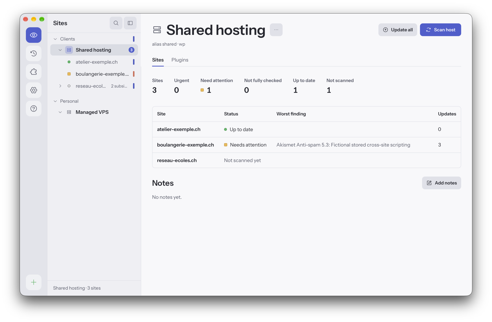

<p align="center">
  
</p>

<h1 align="center">Vigie</h1>

<p align="center">
  Monitor and update your WordPress sites from your own computer, over SSH and WP-CLI.<br>
  Nothing to install on your sites, no account, no hosted service.
</p>

<p align="center">
  <a href="https://github.com/MarJC5/vigie/actions/workflows/ci.yml"></a>
  <a href="https://github.com/MarJC5/vigie/releases/latest"></a>
  <a href="LICENSE"></a>
  
  <a href="go.mod"></a>
</p>

<picture>
  <source media="(prefers-color-scheme: dark)" srcset="docs/images/window-dark.png">
  
</picture>

> **Status: preparing 0.1.0, the first release.** Vigie does everything listed below; its
> interface and its command line may still change before 1.0.

## Contents

- [Why](#why)
- [Features](#features)
- [Install](#install)
- [Usage](#usage)
- [Privacy and security](#privacy-and-security)
- [Documentation](#documentation)
- [Contributing](#contributing)
- [License](#license)

## Why

Managing many WordPress sites usually means a dashboard plugin installed on every site, or an
online service holding access to all of them. Both add an entry point to the sites they are meant
to protect. Vigie takes another route:

- **Agentless**: it connects with SSH and runs WP-CLI on the server. Nothing is added to your sites.
- **Local**: a native app on your machine. No account, no hosted service, no open network port.
- **Read-only by default**: every action that changes a server shows what it will do first, asks
  for confirmation, and is logged.
- **No stored secrets**: your SSH keys stay in your SSH agent (1Password, Bitwarden, ssh-agent).
  Vigie never stores a password.

## Features

- **Site manager**: folders, hosts (one SSH account each) and sites, with colors, notes and tags
  across folders. Every WordPress install of an account found for you; hosts imported from
  `~/.ssh/config`, a CSV list, or FileZilla with the add-on
  [`vigie-filezilla`](https://github.com/MarJC5/vigie-filezilla).
- **Scans**: WordPress, PHP and database versions, pending updates (core, plugins, themes,
  translations), known vulnerabilities, closed or abandoned plugins, files that differ from
  wordpress.org, administrators, TLS certificate and domain expiry, and what changed since the
  previous scan (a new administrator, a plugin installed outside Vigie).
- **Multisite networks** as one site, with the plugins, theme and administrators of each subsite.
- **Safe updates**, on one site or many: a backup first, then each item, the site checked after
  each one, and a rollback on failure; premium plugins included.
- **In the background**: in the menu bar once the window is closed, scans at the interval you
  choose, notifications when a site turns urgent or a long run ends, and a journal of everything.
- **Command line**: `vigie scan`, `vigie update` and more, with JSON output and exit codes for
  scripts and cron.
- **Add-ons**: separate programs that bring hosts from other tools ([docs/addons.md](docs/addons.md)).
- English and French, dark and light, following the system.

## Install

No release is published yet. Once there is one:

| System | How |
| --- | --- |
| **macOS** (12 or later) | The DMG from the [releases](https://github.com/MarJC5/vigie/releases), or `brew install --cask MarJC5/tap/vigie` |
| **Linux** (x86_64, aarch64) | The AppImage, or the deb, rpm or Arch package, from the releases |

Vigie is not notarized by Apple: open it once, then **System Settings**, **Privacy & Security**,
**Open Anyway**; afterwards it opens normally.

**On your servers**: SSH access with a key, PHP on the command line, and WP-CLI. When an account
has no WP-CLI, Vigie offers to install it in its home folder ([docs/security.md](docs/security.md)).

**Updates**: **Settings**, **About** says when a new version is out, with its notes, and installs it
when you click **Install and restart**; nothing is downloaded before. Each update is signed and
checked against the key built into Vigie. Installed with Homebrew: `brew upgrade --cask vigie`;
from a Linux package: your package manager.

## Usage

Add a host with the **+** at the bottom left: its SSH details, its server key to check, a
connection test, then the WordPress installs to add. Select a site, a host or a folder, and scan
it. What needs you shows in the site list, in the overview of each site, and as a notification.

The same from a terminal:

```sh
vigie tree                              # the site manager, each site with its status
vigie scan "Clients/Shared hosting"     # a site, a host or a folder; everything without a path
vigie scan --tag client-dupont --json   # the sites with a tag, as JSON
vigie update "Clients/Shared hosting"   # preview, then update, after you confirm
vigie export -o vigie-export.json       # everything, to move to another computer
```

Exit status: 0 all good, 1 needs attention or not fully checked, 2 urgent, 3 error. `vigie` alone
opens the window. Homebrew links the command; from the DMG, **Settings**, **General**, **Command
line** shows the one command that links it; the Linux packages install `/usr/bin/vigie`.

## Privacy and security

Vigie keeps your data on your computer: no account, no hosted service, no telemetry. A security
scan asks a few outside services what the server cannot tell (known vulnerabilities, closed
plugins, domain expiry), and GitHub whether a new version of Vigie is out, from your computer and
only after you agreed: each one is listed with exactly what it receives, and each one can be
turned off in the settings. Your sites' addresses are never sent to a third party.

What Vigie reads, asks and sends: [docs/security.md](docs/security.md). To report a vulnerability:
[SECURITY.md](SECURITY.md).

## Documentation

- [Security scans: what Vigie reads, asks and sends](docs/security.md)
- [Updates: what Vigie does on a server](docs/updates.md)
- [Vigie in the background](docs/background.md)
- [Data: what Vigie keeps, and its export format](docs/data.md)
- [Add-ons](docs/addons.md)
- [Releasing Vigie](docs/releasing.md)

Each page is also in French, in [docs/fr](docs/fr).

## Contributing

Issues and pull requests are welcome: [CONTRIBUTING.md](CONTRIBUTING.md) says how to build Vigie,
run its tests and propose a change. Everyone taking part follows the
[code of conduct](CODE_OF_CONDUCT.md).

## License

[MIT](LICENSE).

Vigie is not affiliated with or endorsed by the WordPress Foundation. WordPress is a trademark of
the WordPress Foundation.
